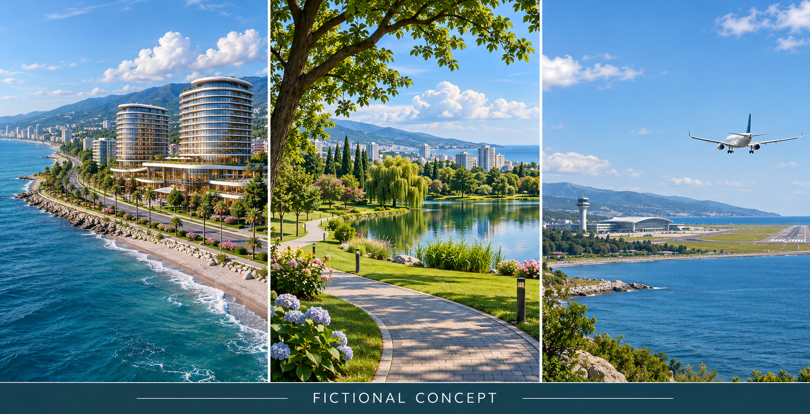

# Batumi Hotel · cinematic prompt kit

Публичный набор промптов и рабочий план коротких рекламных концептов отеля в Батуми.

**Статус: подготовка концепции, не готовое коммерческое видео.** Реальные фотографии объекта, география, права на материалы и параметры заказа требуют подтверждения. Упоминание адреса в исходных промптах не подтверждает соответствие сгенерированных кадров реальному зданию.

## Материалы

- [Сгенерированный концепт: море / парк / аэропорт](assets/fictional-concept-triptych.png)
- [8 исходных промптов на английском](prompts/source-prompts.md)
- [Три приоритетных коротких ролика](prompts/production-prompts.md): со стороны моря, зелёная зона, аэропорт
- [План производства и проверки](docs/production-plan.md)
- [Вопросы для уточнения](docs/questions-ru.md)
- [Происхождение материалов и ограничения](docs/provenance.md)

**Изображение выше — вымышленный AI-концепт**, не фото объекта по указанному адресу. Это единый контактный лист из трёх сцен, а не готовые видеоролики. Исходный PNG: 1752 × 897 пикселей, не 4K. [Промпт изображения](prompts/image-prompt.md).

## Начать работу

1. Подтвердить объект и предоставить разрешённые фото/видео или архитектурные референсы.
2. Ответить на вопросы в брифе. Предложение для согласования: три ролика по 6–8 секунд, 16:9; это не подтверждённые требования заказчика.
3. Сначала согласовать статичные кадры, затем генерировать движение по одному плану.
4. Проверить геометрию здания, направление к морю/парку/аэропорту и маркировку AI-концепта перед коммерческой отправкой.

В репозитории нет видео, закрытой переписки, контактных данных, API-ключей, платных интеграций или автоматических заданий. `4K` в исходных промптах — пожелание, а не характеристика уже готового файла.

## English summary

A public production brief and eight source prompts for short Batumi hotel video concepts. Russian is the collaboration language; English prompts are preserved for generation tools. Output remains a concept until property references, rights, geography and delivery specifications are approved. No actual hotel footage or final video is included.
